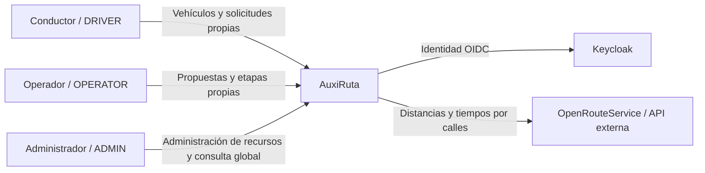
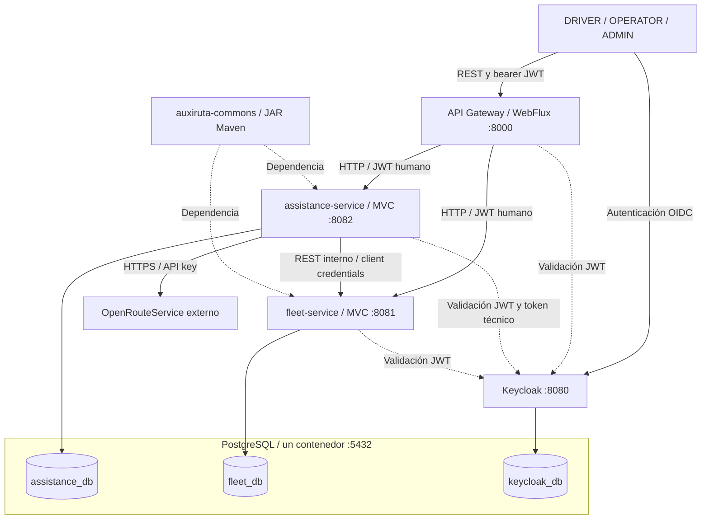

# AuxiRuta — Diagramas C1 y C2

Línea base AR-MVP-5, 4 de noviembre de 2026. Fuente vigente del diseño; implementación pendiente. Los archivos AuxiRuta_C1.png y AuxiRuta_C2.png son antecedentes históricos y quedan sustituidos por estos diagramas.

## C1 — Contexto

La selección, los vencimientos y las búsquedas alternativas previas al despacho se deciden mediante reglas automáticas. ADMIN administra recursos y consulta; el alta de operadores pertenece a la empresa.

## C2 — Contenedores

Assistance administra vehículos, solicitudes, evaluación, selección, estados y tareas de recuperación. Fleet administra operadores, equipos y reservas exclusivas. El JAR común es una dependencia, no un contenedor. Solo Gateway y Keycloak publican puertos al host. No existe una base adicional para logs ni notificaciones.

Desde DISPATCHED se mantiene la asignación hasta la entrega.
