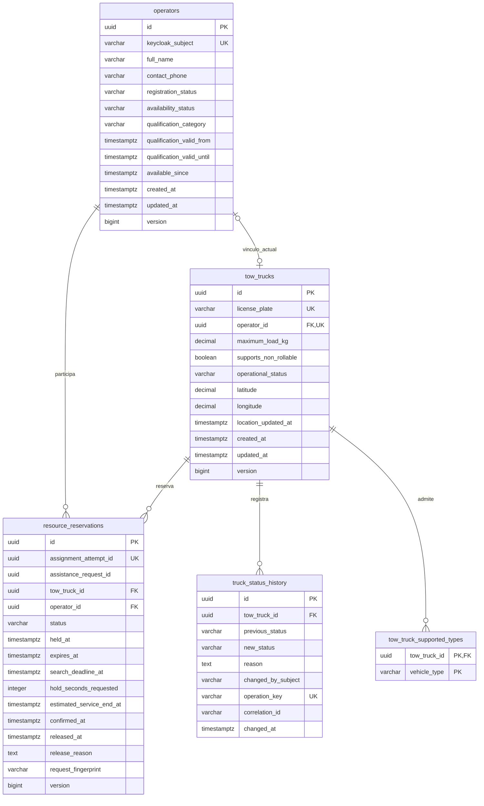

# AuxiRuta — Diagrama entidad-relación

Línea base AR-MVP-5. Diseño lógico editable; SQL y entidades pendientes de implementación. El [modelo persistente](../documentacionPartes/AuxiRuta-modelo-persistente-MVP.md) define nulos, semántica y restricciones compuestas; este diagrama representa atributos y cardinalidades. bd1.png y bd2.png son antecedentes previos a la consolidación.

## assistance_db — assistance-service

```mermaid
erDiagram
    vehicles {
        uuid id PK
        varchar owner_subject
        varchar license_plate UK
        varchar brand
        varchar model
        varchar vehicle_type
        decimal declared_weight_kg
        varchar registration_status
        timestamptz created_at
        timestamptz updated_at
        bigint version
    }
    assistance_requests {
        uuid id PK
        uuid vehicle_id FK
        varchar driver_subject
        varchar status
        timestamptz first_assigned_at
        varchar closure_reason_code
        decimal origin_latitude
        decimal origin_longitude
        decimal destination_latitude
        decimal destination_longitude
        varchar declared_vehicle_type
        decimal declared_weight_kg
        varchar mobility_condition
        varchar description
        integer search_attempt_number
        timestamptz search_deadline
        varchar configuration_revision
        text configuration_snapshot
        varchar idempotency_key
        varchar request_fingerprint
        timestamptz created_at
        timestamptz updated_at
        timestamptz closed_at
        bigint version
    }
    assignments {
        uuid id PK
        uuid request_id FK
        uuid candidate_evaluation_id FK
        uuid fleet_reservation_id
        uuid tow_truck_id
        uuid operator_id
        varchar operator_subject
        varchar status
        timestamptz created_at
        timestamptz reserved_at
        timestamptz proposed_at
        timestamptz expires_at
        timestamptz accepted_at
        timestamptz dispatched_at
        timestamptz arrived_at
        timestamptz loaded_at
        timestamptz transport_started_at
        timestamptz completed_at
        timestamptz ended_at
        text end_reason
        bigint version
    }
    evaluations {
        uuid id PK
        uuid request_id FK
        integer search_attempt_number
        decimal origin_latitude
        decimal origin_longitude
        decimal destination_latitude
        decimal destination_longitude
        decimal transport_distance_m
        decimal transport_duration_seconds
        integer adjusted_transport_seconds
        timestamptz route_obtained_at
        varchar vehicle_type
        decimal declared_weight_kg
        varchar mobility_condition
        integer maximum_arrival_seconds
        integer loading_seconds
        integer unloading_seconds
        integer operational_margin_seconds
        varchar configuration_revision
        text coverage_and_admission_summary
        varchar result
        varchar reason_code
        text reason_detail
        timestamptz evaluated_at
    }
    candidate_evaluations {
        uuid id PK
        uuid evaluation_id FK
        uuid tow_truck_id
        uuid operator_id
        varchar operator_subject
        decimal truck_capacity_kg
        varchar qualification_category
        timestamptz qualification_valid_until
        decimal truck_latitude
        decimal truck_longitude
        timestamptz truck_location_updated_at
        boolean compatible
        boolean eligible
        varchar reason_code
        decimal approach_distance_m
        decimal approach_duration_seconds
        integer adjusted_approach_seconds
        timestamptz approach_route_obtained_at
        decimal transport_distance_m
        decimal transport_duration_seconds
        integer adjusted_transport_seconds
        timestamptz transport_route_obtained_at
        timestamptz estimated_service_end_at
        integer ranking_position
    }
    request_status_history {
        uuid id PK
        uuid request_id FK
        varchar previous_status
        varchar new_status
        varchar actor_subject
        varchar actor_type
        text reason
        text details
        varchar operation_key
        varchar request_fingerprint
        varchar correlation_id
        timestamptz occurred_at
    }
    pending_fleet_actions {
        uuid id PK
        varchar operation_key UK
        uuid request_id FK
        uuid assignment_id FK
        varchar action_type
        uuid tow_truck_id
        uuid operator_id
        varchar vehicle_type
        decimal declared_weight_kg
        varchar mobility_condition
        timestamptz search_deadline_at
        integer hold_seconds_requested
        timestamptz estimated_service_end_at
        text reason
        varchar status
        integer attempt_count
        timestamptz next_attempt_at
        text last_error
        varchar correlation_id
        timestamptz created_at
        timestamptz completed_at
        bigint version
    }
    vehicles ||--o{ assistance_requests : recibe
    assistance_requests ||--o{ evaluations : evalua
    evaluations ||--o{ candidate_evaluations : compara
    assistance_requests ||--o{ assignments : propone
    candidate_evaluations ||--o{ assignments : fundamenta
    assistance_requests ||--o{ request_status_history : registra
    assistance_requests ||--o{ pending_fleet_actions : recupera
    assignments ||--o{ pending_fleet_actions : origina
```

## fleet_db — fleet-service

Cada hijo pertenece a exactamente un padre en las relaciones N→1. Un operador y una grúa pueden estar desvinculados; cada uno admite como máximo un vínculo actual. Las reservas históricas son múltiples, pero la exclusividad de HELD/CONFIRMED se garantiza transaccionalmente y mediante restricciones, no mediante la cardinalidad histórica del diagrama.

## keycloak_db — Keycloak

Keycloak administra y actualiza su esquema de usuarios, credenciales, roles, clientes y realm. El equipo configura esos recursos mediante las herramientas del proveedor y no define sus tablas ni entidades JPA. Se documenta como almacén separado en C2; no se replica un DER interno dependiente de la versión de Keycloak.

Los subjects y referencias entre servicios son identificadores externos sin FK ni relaciones JPA entre bases. No hay tablas de negocio en keycloak_db.
